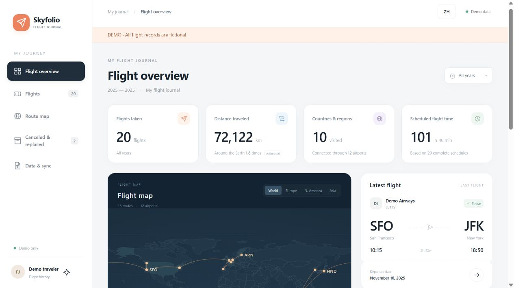

<div align="center">

# ✈ Skyfolio · Flight Journal

**Flight history, route maps and Excel sync.**

An interactive flight journal powered by your local Excel workbook.

**English** · [Chinese](README.zh-CN.md)

[Live demo](https://zjlshuyu110.github.io/skyfolio/demo/?lang=en) · [Quick start](#quick-start) · [Publish the demo](#publish-the-demo)

</div>



## Features

View your flights on a map, check travel statistics and look up booking details. Save changes in Excel to update the app.

| Feature | What it does |
| --- | --- |
| Interactive map | Great-circle routes, region presets, zoom, pan and clickable routes. |
| Search & filters | Find flights by number, city, airport or booking; filter by year and airline. |
| Travel statistics | Flights taken, estimated distance, airports, countries/regions and scheduled duration. |
| Evidence preserved | Original notes, booking references, source links and inferred-field labels. |
| Separate change history | Canceled and replaced tickets do not count toward flown totals. |
| Excel auto-sync | Checks saved changes about every 3 seconds; retains the last good snapshot during read failures. |
| English & Chinese | Switch instantly; the browser remembers your language. |
| Static demo | Share the interface without publishing a personal workbook. |

An independent project, not affiliated with Flighty. This is a history journal, not a live flight tracker.

## Try the demo

The demo contains **20 fictional flights and 2 canceled examples**. Flight numbers, times and booking references are synthetic. It never reads your workbook or calls the Excel API.

On Windows, double-click **Start Demo.cmd**. Otherwise, run from the project root:

```sh
python -m http.server 8766 --bind 127.0.0.1 --directory docs
```

Open **http://127.0.0.1:8766/demo/**. Use the language button, or add `?lang=en` / `?lang=zh-CN` to the URL. Serve the folder over HTTP rather than opening the HTML file directly.

**[Open the live demo](https://zjlshuyu110.github.io/skyfolio/demo/?lang=en)** — hosted on GitHub Pages from `docs/`.

## Quick start

Requires **Python 3.10+**, a modern browser and an `.xlsx` workbook.

```sh
python -m pip install -r requirements.txt
python outputs/flight-journal/app.py --workbook "/absolute/path/to/flights.xlsx"
```

Open **http://127.0.0.1:8765/?lang=en**.

For the Windows launcher, edit `workbook` in `outputs/flight-journal/config.json`, then double-click **Start Flight Journal.cmd**. Relative paths resolve from the configuration folder. Forward slashes work for Windows JSON paths.

The launcher reuses an existing Codex Python runtime or falls back to `python` on PATH. The bundled configuration points to the owner's private workbook folder, which is excluded from Git: a fresh clone needs your own workbook and path. **Open Excel** uses Windows file associations; on other platforms open the workbook manually.

### Workbook format

Use the English sheet names and headers below. Chinese workbooks are also supported; see the [Chinese README](README.zh-CN.md) for that format. Interface and workbook languages are independent. Headers can be reordered and must appear within the first 20 rows. Do not include both language versions of the same sheet or column.

| Sheet | Purpose |
| --- | --- |
| `Flights` | Required main flight sheet. |
| `Canceled` | Optional canceled/replaced tickets. |
| `Research notes` | Optional legacy notes: title/detail/context in columns C–E, from row 5. |

| Headers | Meaning |
| --- | --- |
| `Departure date` | Departure date, YYYY-MM-DD or Excel date; required for a row to appear. |
| `Flight number` | Flight number. |
| `Origin`, `Destination` | Required headers. Values start with IATA codes, e.g. SFO San Francisco. |
| `Departure time`, `Arrival date`, `Arrival time` | Scheduled local departure time, arrival date and arrival time; HH:MM or Excel time. |
| `Airline`, `Booking reference` | Airline and booking reference. |
| `Evidence`, `Status` | Evidence description and flight status. |
| `Notes`, `Source mailbox`, `Email date` | Original notes and source metadata. |
| `Source URL`, `Additional URLs` | HTTP(S) source URLs, one per line. |

Statuses `Flown`, `Inferred flown`, and `Imported` count as flown. Status matching ignores capitalization. `Excluded`, `Not flown`, `On hold` and `Canceled` do not count. Canceled-sheet entries never count. Other statuses remain in the main list without contributing to flown totals. Original notes and evidence are not translated.

Invalid departure dates are skipped with a notice. Incomplete times omit duration; unknown airport codes omit their map positions and distance estimates. Enter the correct arrival date for overnight/date-line journeys.

## Publish the demo

1. Rebuild the static files after changing the UI: `python scripts/build_demo.py`.
2. Review and push your source and `docs/` folder to your chosen repository.
3. In **Settings → Pages → Build and deployment**, choose **Deploy from a branch**, your publishing branch, and **/docs**. Save.
4. Add the resulting URL to the repository's About section and both READMEs.

See [GitHub's publishing-source guide](https://docs.github.com/en/pages/getting-started-with-github-pages/configuring-a-publishing-source-for-your-github-pages-site). Pages serves the static preview; the Python Excel service stays local. This repository publishes its demo from the `main` branch, `/docs` folder.

## Structure & privacy

- `outputs/flight-journal/`: Python service, configuration, launchers and `web/` UI.
- `outputs/flighty-history-20261007/`: private workbook, ignored by Git.
- `scripts/`: fictional data generation and allowlisted static build.
- `docs/demo/`: generated public demo; `docs/assets/`: fictional-data screenshots.
- `tests/`: public checks.
- `work/`: private research, backups and logs, ignored by Git.

The demo build copies only explicitly listed frontend files and never reads personal workbooks or research archives. Ignore rules exclude personal Excel, evidence, personal screenshots and logs. Review staged files before publishing: ignore rules do not remove already-tracked files.

## Development

Plain JavaScript, CSS and SVG; no npm install or frontend framework required. Edit `outputs/flight-journal/web/`; translations are in `i18n.js`.

```sh
python scripts/build_demo.py
python -m unittest discover -s tests -v
```

To regenerate fictional data, install requirements and run `python scripts/generate_demo.py`, then rebuild. Private historical tests remain in the ignored work folder.

Distance is estimated between airports, not along the flown track. Duration uses scheduled timestamps and airport time zones, not actual airborne time. Country/region counts include connection airports.

## Credits

[Natural Earth](https://www.naturalearthdata.com/about/terms-of-use/) supplies the public-domain map. [airportsdata](https://github.com/mborsetti/airportsdata) supplies airports/time zones under its [MIT license](outputs/flight-journal/web/data/airports-LICENSE.txt). [OurAirports](https://ourairports.com/data/) supplies historical airport supplements.

Third-party data retains its own licensing. A license for the project's original code has not yet been selected.


